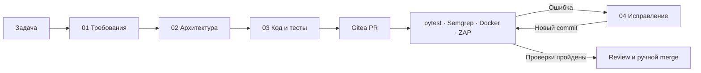

# Talos AI DevSecOps

Локальный стенд разработки с ИИ: от описания задачи до Pull Request с тестами, документацией и результатами проверок. Модели работают через Ollama, процесс собран в SIM, код и CI — в Gitea. Серверные компоненты размещаются на одноузловом Talos/Kubernetes.

Основная задача проекта — связать генерацию кода с обычным процессом разработки. Изменения попадают в отдельную ветку, проверяются конвейером и при ошибке возвращаются на ограниченный цикл исправлений. Решение о merge остаётся за человеком.



## Что здесь есть

- Четыре workflow SIM и Python-код для их сборки.
- Общий Gitea Actions pipeline: тесты, статический анализ, запуск контейнера, ZAP и публикация отчётов.
- Передача контекста через Generic Packages с привязкой к `run_id`, PR и commit SHA.
- Проверки разрешённых путей, защита от записи в `main`, ограничение числа исправлений.
- Скрипты установки Talos-лаборатории и небольшой FastAPI-пример.

## Проверить без кластера

Нужны Python 3.12, Node.js 22 и Bash. Команды выполняются из корня репозитория:

```bash
git clone https://github.com/MrMayow/talos-ai-devsecops.git
cd talos-ai-devsecops
python -m venv .venv
source .venv/bin/activate
python -m pip install -r requirements-dev.txt
python scripts/check.py
```

В PowerShell окружение активируется командой `.\.venv\Scripts\Activate.ps1`. Для Bash можно использовать Git for Windows; если в PATH первым стоит WSL launcher, задайте `BASH_BINARY` с путём к Git Bash.

Проверка выполняет тесты Function-блоков, проверяет графы и контракты workflow, синтаксис Bash, JSON/YAML и тесты [демонстрационного API](examples/calculator-api/README.md). GPU и доступ к SIM/Gitea для этого не нужны. Ключ `--rebuild` дополнительно собирает оба комплекта во временном каталоге и проверяет результат.

## Запустить полный процесс

1. Подготовить SIM, Ollama, Gitea и доверенный runner с Docker.
2. Выбрать профиль и подготовить импорты под свой **Gitea**-репозиторий:

   ```bash
   python scripts/export_workflows.py --profile demo --owner labadmin --repo demo-fastapi
   ```

3. Импортировать файлы из `build/imports/demo` в SIM в порядке `04 → 03 → 02 → 01`.
4. Настроить подключения и CI по [инструкции](docs/setup.md), выполнить [проверочный сценарий](docs/demo.md).

GitHub хранит этот проект. Gitea внутри лаборатории хранит приложения, создаваемые workflow. Это разные репозитории.

## Два профиля

| | `demo` | `strict` |
|---|---|---|
| Назначение | Короткий демонстрационный маршрут | Дополнительные reviewers и проверки |
| Согласование | Требования и архитектура | Требования, архитектура и код |
| Модель по умолчанию | `qwen3-coder-next:latest` | Два alias Qwen 2.5 14B |
| Исправления CI | До пяти попыток | До пяти попыток |
| Финальный merge | Вручную | Вручную |

Модель демопрофиля может требовать существенно больше ресурсов, чем 14B. Настройку моделей и ограничения контекста см. в [models](models/README.md). Workflow разных профилей в одной цепочке не смешиваются.

## Как устроен репозиторий

```text
profiles/       workflow, сборщики и тесты двух профилей
platform/       файлы CI для целевого приложения в Gitea
infra/talos/    установка одноузловой лаборатории
models/         Ollama Modelfile и проверки подключения
examples/       FastAPI-приложение для проверки конвейера
scripts/        локальные проверки и подготовка импортов
docs/           архитектура, настройка и эксплуатация
```

## Статус и ограничения

Это лабораторный проект. Экспорты рассчитаны на интерфейс SIM v0.7.29; совместимость с другими версиями нужно проверять при импорте. Локальные тесты не заменяют запуск всей цепочки на живом стенде.

Talos-установка одноузловая, storage локальный, runner использует privileged Docker-in-Docker. Изоляция CI недостаточна для недоверенных внешних PR. Приложение проверяется в Docker; автоматического развёртывания в Kubernetes и автоматического merge здесь нет. Fuzzing в текущей политике отключён.

Подробнее: [архитектура](docs/architecture.md), [решения](docs/decisions.md), [безопасность](docs/security.md), [проверки](docs/validation.md).

## Лицензия

[MIT](LICENSE). Сторонние платформы, образы и модели распространяются по собственным лицензиям; см. [зависимости проекта](docs/dependencies.md).
