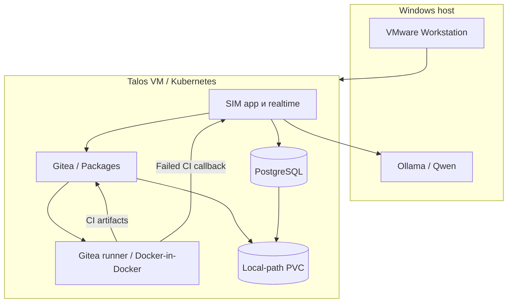

# Архитектура

Стенд разделяет три задачи: модель предлагает изменение, workflow проверяет и записывает его, CI проверяет полученный код. Модель не получает Kubernetes-конфигурацию и не выполняет команды Git напрямую.

Ollama остаётся на Windows, чтобы использовать GPU без passthrough в VMware. SIM, Gitea и runner размещаются в Kubernetes. PostgreSQL хранит состояние SIM, а локальные PVC — данные сервисов. Для другой инфраструктуры workflow можно использовать отдельно от Talos-скриптов.

## Этапы

| Этап | Вход | Результат |
|---|---|---|
| 01 — требования | Запрос и ограничения | Согласованные требования и ссылка на артефакт |
| 02 — архитектура | Требования | Архитектура, профиль реализации, план файлов |
| 03 — реализация | Утверждённый план | Файлы, ветка `ai/<run_id>`, PR |
| CI | Точный head SHA PR | Тесты, findings, машинный summary и отчёты |
| 04 — исправление | CI evidence и исходный development context | Новый commit в том же PR либо терминальный результат |

В `strict` шаг 01 включает проверку и исправление требований через отдельные async executions. Это позволяет сохранить checkpoint и продолжить процесс без одного чрезмерно длинного вызова. В `demo` требования и архитектура проходят более короткий путь, а генерация приложения, тестов и документации разделена между вызовами модели.

## Контракты

Артефакты передаются через Gitea Generic Packages. Для одного запуска сохраняются `requirements.json`, `architecture.json` и `development-contract.json`; ссылки на них передаются следующим этапам. В development contract входят утверждённые файлы и контекст, необходимый для исправления.

CI публикует `ci-summary.json`, `findings.json`, `pytest.log`, JUnit XML и отчёты анализаторов. Контекст содержит `run_id`, `pr_number`, `context_version` и `repair_attempt`. Номер попытки Gitea Actions и номер AI-исправления — разные значения.

Перед исправлением Workflow 04 проверяет соответствие репозитория, ветки, PR и SHA. При изменившемся head записывать старое исправление нельзя. После записи проверяется результат каждого API-запроса, затем выполняется один `workflow_dispatch` для итогового состояния ветки.

## Границы изменений

Генератор работает с одним разрешённым целевым репозиторием. Названия `labadmin/demo-fastapi` в исходных шаблонах — пример конфигурации; `scripts/export_workflows.py` подставляет выбранные owner и repo и сохраняет результат в `build/`.

Служебные пути `.gitea/**`, `ci/**`, секреты и переменные окружения не входят в область генерации. Merge выполняется в Gitea вручную, после проверки PR и результатов CI. Это ограничение исполнителя, а не предположение о добросовестности модели.

## Версии

`profiles/strict` сохраняет контракты комплекта v5. `profiles/demo` содержит упрощённую линию 1.9.1. Имена файлов оставлены с версиями, чтобы импорты можно было отличать в SIM. Код сборщика demo использует strict как источник общих блоков; общая CI-платформа лежит отдельно в `platform/`.
